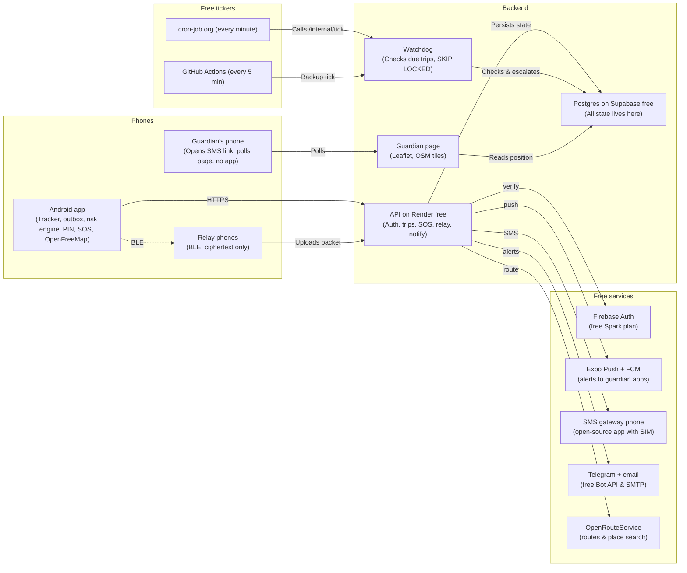

# Technical Requirements Document (TRD)

> **Title**: Technical Requirements Document (TRD)  
> **Source Sections**: Section 8 (Architecture overview, Technology decisions, Backend modules, Watchdog design, Background tracking, Observability)  
> **Owner**: Dev A & Dev C  
> **Status**: Frozen  
> [← Back to Documentation Index](README.md)

---

## 8. Technical Requirements Document (TRD)

The architecture keeps all critical state in Postgres and drives the watchdog from a free external clock, so a sleeping free-tier host never silences protection.

### 8.1 Architecture overview

The Android app talks to a Node/Express API over HTTPS and to nearby phones over BLE (encrypted packets only). The API keeps state in Postgres, sends push through Expo and SMS through a gateway phone, and serves the guardian tracking page. Two free external tickers wake the watchdog every minute.

*The highlighted watchdog runs whenever a ticker calls it, so a sleeping free host cannot silence protection.*

---

### 8.2 Technology decisions

| Layer | Choice (all free) | Why and what to watch |
| :--- | :--- | :--- |
| **Mobile** | Expo SDK 54 dev build (not Expo Go), Android first, built locally with `npx expo run:android` | Background location and BLE need native modules. Local Gradle builds are unlimited and queue-free; EAS cloud builds stay a backup because the free tier is a low-priority queue with a small monthly quota |
| **Identity** | Firebase Auth, email and password, Spark plan* | Keep login as is. The server verifies the ID token with `firebase-admin`. Never enable phone auth or Identity Platform (paid) |
| **API** | Express 5 + zod (scaffold exists in `artifacts/api-server`) | Zero setup cost |
| **Contract** | OpenAPI (`lib/api-spec/openapi.yaml`), Orval, api-client-react and api-zod | Our main integration seam (section 16) |
| **Database** | Supabase free Postgres, accessed only as plain Postgres through Drizzle | 500 MB, 2 projects, pause after 1 week idle. Use Supabase's pooled connection string (IPv4) and verify it from the host on day zero. Do not use Supabase Auth, Storage or Realtime: one identity system only |
| **Hosting** | Render free web service built from the GitHub repo | No card. Spins down after 15 min without traffic and takes about a minute to wake; 750 free hours a month. Do not use Render's free Postgres (it expires after 30 days) |
| **Watchdog clock** | cron-job.org* every minute plus a GitHub Actions scheduled workflow* every 5 minutes, both calling `POST /internal/tick` | Two independent tickers, no single clock. Tickers also keep the host warm |
| **Push** | Expo Push service, FCM credentials from the free Firebase project* | No cost at this volume |
| **SMS** | `SmsProvider` interface with `console` and `android-gateway` providers; production `dlt-gateway` provider is a later, paid swap | SMS Gateway for Android is open source (Apache-2.0), needs no registration, and offers a cloud-server mode with a public API so our hosted server can reach the phone. Turn on its end-to-end encryption passphrase and put only a tokenised link in the message |
| **Other free channels** | Telegram Bot API; email through a free SMTP account (Gmail app password or Brevo free)*; WhatsApp click-to-chat link from the user's own phone | Guardians choose a channel at consent. Telegram and email need a smartphone or inbox, so SMS stays the feature-phone path |
| **In-app maps** | `@maplibre/maplibre-react-native`* with the OpenFreeMap style | Free, no key, no request limit. It offers no search or routing, and the public instance is donation-funded with no SLA. Show attribution |
| **Routing, ETA** | OpenRouteService free key, called only from our backend | 2,000 directions and 1,000 geocoding requests a day. Cache by origin cell and destination; fall back to a straight-line ETA. The key never ships inside the app |
| **Place search** | OpenRouteService geocoding; Nominatim as fallback* | Debounce typing; respect Nominatim's roughly 1 request per second policy |
| **Guardian page** | Server-rendered HTML + Leaflet from a free CDN, OpenStreetMap raster tiles, polling every 5–10 s, with a no-JavaScript fallback (last position as text plus an OpenStreetMap link and meta-refresh) | Works on basic browsers; MapLibre GL needs WebGL and would exclude low-end phones. OSM tiles suit light use only, so the tile URL is an environment variable that can switch provider |
| **Crypto** | `tweetnacl` (X25519 box, Ed25519 signatures) + `expo-crypto` | Small, audited, pure JS, identical on app and server |
| **Local storage** | `expo-sqlite` (outbox, relay cache), `expo-secure-store` (keys, PIN hashes) | Offline queue and secrets |
| **Background** | `expo-location` + `expo-task-manager`, Android foreground service | Keeps tracking when the screen is off |
| **BLE** | `react-native-ble-plx` (scan) + a BLE advertiser library (confirmed in the spike, see 11.6) | Transport sits behind an interface so it can be swapped or simulated |
| **Source and CI** | Public GitHub repository, GitHub Actions, pnpm | Free for public repositories* |

---

### 8.3 Backend modules

| Module | Responsibility |
| :--- | :--- |
| **auth** | Verify Firebase ID token; attach `req.user`; per-user rate limits |
| **me / guardians** | Profile, public keys, push token, guardian CRUD, consent flow across SMS, Telegram and email |
| **trips** | Create, batch location ingest, end, share-link create/revoke |
| **sos** | Create (idempotent), cancel, duress flag, acknowledge, status |
| **relay** | Gateway upload of BLE packets: verify, dedupe, decrypt, fan-out |
| **watchdog** | Worker applying the rules in FR-05; invoked by the tick endpoint and by a boot-time catch-up sweep |
| **internal** | `POST /internal/tick`, protected by a shared secret header (constant-time compare), idempotent, rate-limited |
| **notify** | Push, SMS-gateway, Telegram and email dispatch with per-recipient delivery status, retries and channel fallback |
| **routing** | OpenRouteService proxy with cache, daily quota counter and straight-line fallback |
| **public** | Guardian tracking page and its JSON endpoint (token-based, no auth) |
| **safety** | Zones, reports, abuse limits |
| **audit** | Append-only log of who viewed or did what |

---

### 8.4 Watchdog design

The watchdog no longer depends on an always-on process. All state lives in Postgres: each active trip has `last_seen_at`, `eta_at`, `next_check_at` and `escalation_stage`. Any request that wakes the server can run the due checks.

- **Clock.** `cron-job.org` calls `/internal/tick` every minute; a GitHub Actions scheduled workflow calls it every 5 minutes as an independent backup (GitHub's schedule is best-effort and may run late). While the server is awake it also runs an in-process 15-second loop.
- **Query pattern.** `SELECT ... WHERE next_check_at <= now() FOR UPDATE SKIP LOCKED`, so overlapping ticks and instances never escalate the same trip.
- **Idempotency.** Every escalation writes an `escalations` row with a unique key `(trip_id, stage)`, so retries are safe. Stages: `signal_lost` $\rightarrow$ `user_prompted` $\rightarrow$ `guardians_alerted`. Thresholds come from environment variables.
- **Cold start.** On boot the server runs a catch-up sweep immediately. The worst case is the wake-up time (about a minute) plus the tick interval; the demo threshold is set well above that.
- **Missed ticks.** A `tick_log` table records each tick. If no tick arrived for 3 minutes, `/api/readyz` reports degraded and the next tick logs the gap, so we can show honest numbers.
- **Demo hosting.** Run one always-on option as the demo primary if available (a team laptop with a Cloudflare quick tunnel*), with the Render deployment as the standing backup.

---

### 8.5 Background tracking (fixes the 1.0 bug)

- A TaskManager task `SAFARSAATHI_LOCATION` starts with `startLocationUpdatesAsync`, using an Android foreground-service notification.
- Use `timeInterval: 15000` with `distanceInterval: 0`, so updates are time-driven. In 1.0 a stationary user produced no updates, which meant stop detection never ran.
- Each fix is appended to an SQLite outbox; a flusher sends batches to `POST /v1/trips/{id}/locations` and deletes rows only after a 2xx.
- The same feed drives the local risk engine for instant feedback, while the server watchdog stays the authority for escalation.

---

### 8.6 Observability and operations

- `pino` logs with request IDs; never log coordinates or phone numbers. Render's free log stream is enough for the demo.
- `/api/healthz` (exists) and `/api/readyz` (database ping plus last-tick age). UptimeRobot* watches `/api/healthz` and alerts the team by email.
- A daily quota check records OpenRouteService usage and Supabase database size, and the team reviews both each morning of the build.
- `audit_log` entries for: guardian viewed link, SOS created, SOS acknowledged, data deleted.
- A seed script creates demo data (users, guardians, zones) so the demo is reproducible.

